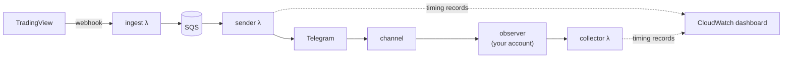
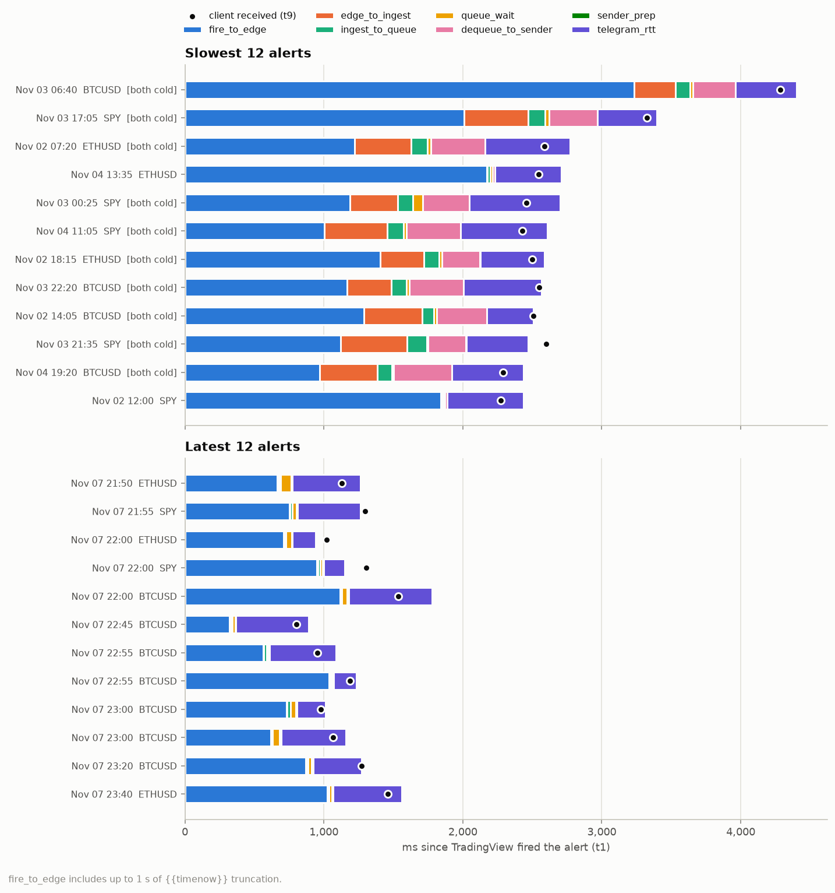
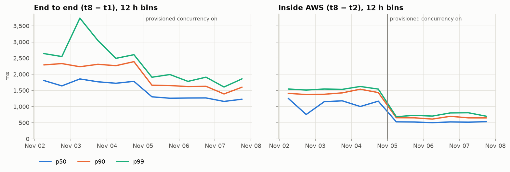
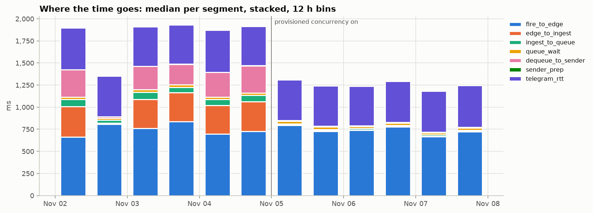
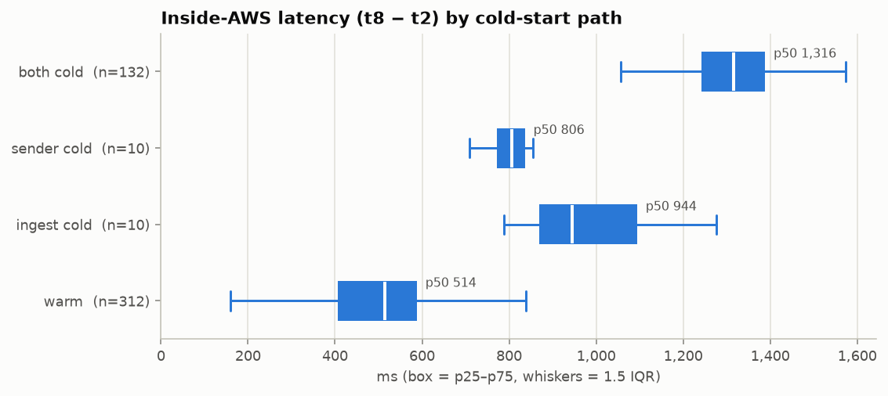
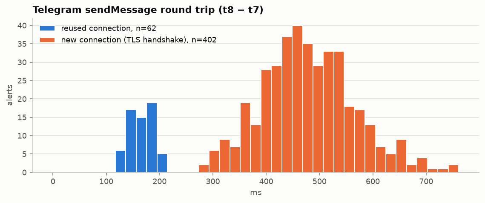
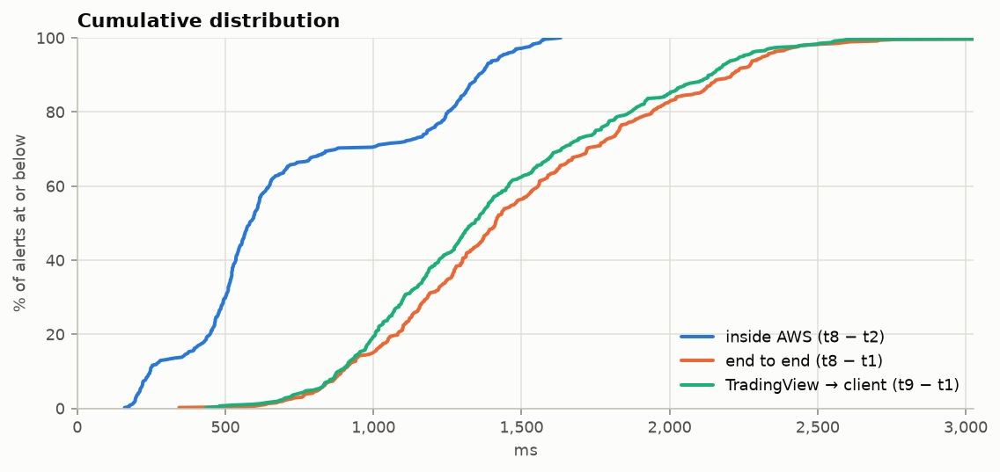

# tv-tg-bot

TradingView alerts → AWS → Telegram, with every hop timed, from the TradingView bar close to the moment a real
Telegram client receives the message.



| | |
|---|---|
| **Design** | [docs/design.md](docs/design.md): constraints, architecture, timing model, failure handling, decisions |
| **Plan** | [docs/plan.md](docs/plan.md): phases, status, risks |
| **Deploy / runbook** | [docs/deploy.md](docs/deploy.md): what to do once AWS and GitHub credentials are available |

**Status:** implemented and tested locally (195 Python tests at 99% coverage; 13 `terraform test` runs against mock
AWS providers; ASH security scan clean at MEDIUM+). Not deployed yet.

## Mock latency graphs

Generated from [mock data](tools/mockdata.py) that runs through the same timing code the Lambdas use:
6 days at ~3 alerts an hour, with provisioned concurrency switched on halfway through. The same
[graph tool](tools/graphs.py) runs on real CloudWatch exports. Full table: [summary](docs/img/mock/summary.md).





| | |
|---|---|
|  |  |



## Local development

```bash
make venv          # .venv with requirements-dev.txt
make check         # ruff + pytest (coverage gate 95%) + terraform fmt/validate/test
make ash-install   # once: ASH v3.8.0 + scanners into ~/.ash (outside the repo, as ASH requires)
make ash           # security scan (config .ash/.ash.yaml); `make check-all` = check + ash
make graphs        # mock data -> out/mock-graphs/*.png + summary.md
make docs-graphs   # regenerate the images above
```

Tests run the real handler code against moto (SSM, SQS, DynamoDB) and a real local HTTP server that fakes the
Telegram Bot API, including keep-alive reuse and stale-connection recovery. `tests/test_e2e.py` drives a webhook
through ingest → SQS → sender → Telegram → observer → collector, then renders graphs from the records it logged.

## Layout

| Path | What |
|---|---|
| `src/tvtg/` | Lambda package: `ingest`, `sender`, `collector`, plus `timing`, `telegram`, `render`, `emf`, `config` |
| `observer/` | Reception observer: `observer.py`, `install.sh` (Pi / any Linux), `compose.yaml` (Docker); EC2 via `observer_host = "ec2"` |
| `pine/` | TradingView canary indicator and alert message template |
| `tools/` | `mockdata`, `graphs`, `export_logs` |
| `tests/` | Unit + end-to-end tests |
| `infra/` | Terraform: `bootstrap/` (state bucket, OIDC roles), `modules/{pipeline,observability,observer_ec2}`, `envs/{dev,prod}` |
| `.github/workflows/` | `ci` (lint, tests, mock graphs, terraform validate/test, observer image, PR plan), `ash` (security scan → code scanning), `deploy` → `tf-apply` (dev → approved prod). Actions pinned to SHAs |
| `.ash/.ash.yaml` | ASH configuration: threshold, ignored paths, the one config-level suppression |
