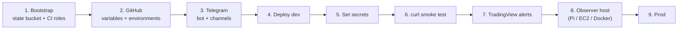
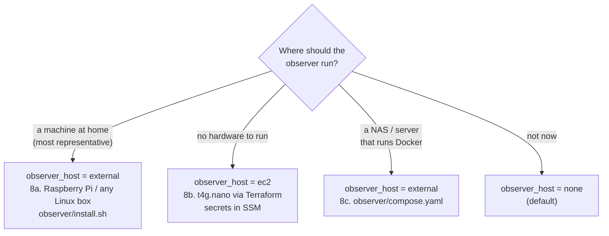

# Deploy and operate

Everything here needs your AWS account and GitHub repo. The rest of the repo already runs locally
(`make venv check graphs`).



**Prerequisites:** an AWS account (ideally used only for this), AWS CLI v2 signed in as an admin, Terraform ≥ 1.10, a
TradingView plan that includes webhooks, with 2FA turned on, and a Telegram account.

## 1. Bootstrap (once, from your machine)

```bash
cd infra/bootstrap
terraform init
terraform apply -var github_repo=jalijabe/tradingview-to-telegram -var state_bucket=tvtg-tfstate-$(openssl rand -hex 4)
```

Note the outputs `state_bucket`, `plan_role_arn` and `deploy_role_arn`. This stack keeps local state on purpose. Keep
`infra/bootstrap/terraform.tfstate` somewhere safe; it's git-ignored.

## 2. GitHub

- Repository **variables**: `TF_STATE_BUCKET`, `AWS_PLAN_ROLE_ARN`, `AWS_DEPLOY_ROLE_ARN`.
- **Environments** `dev` and `prod`. Give `prod` a required reviewer. Set these variables on each environment:
  `CHAT_ID`, `CANARY_CHAT_ID`, `ALARM_EMAIL`, and optionally `OBSERVER_HOST` (`none` / `external` / `ec2`) and
  `OBSERVER_REGION` (step 8).
- No secrets go into GitHub. CI uses OIDC, and the bot token etc. live in SSM (step 5).
- **Code scanning** (for ASH's SARIF): automatic on public repos. On a private repo it needs GitHub Advanced
  Security; without it the scan still gates the PR, and the reports are kept as the `ash-reports` artifact.
- Branch protection on `main`: require the `ci` and `ash` checks.

## 3. Telegram

1. In @BotFather run `/newbot`, then copy the token.
2. Create a **private channel** for alerts and a second one for canaries, with notifications muted. Add the bot to
   both as an **admin** with "Post messages".
3. Post anything in each channel, then read the ids (`-100…`):
   ```bash
   curl -s "https://api.telegram.org/bot<TOKEN>/getUpdates" | python3 -m json.tool | grep -A3 '"chat"'
   ```

## 4. Deploy dev

Push to `main` (the `deploy` workflow applies `infra/envs/dev`), or run it locally:

```bash
cd infra/envs/dev
terraform init -backend-config="bucket=<TF_STATE_BUCKET>" -backend-config="key=tv-tg-bot/dev.tfstate"
terraform apply -var chat_id=-100… -var canary_chat_id=-100… -var alarm_email=you@example.com
terraform output
```

Confirm the SNS email subscription when it arrives.

## 5. Set secrets (SSM)

Terraform created placeholder values. Replace them; these values never pass through Terraform state:

```bash
P=/tvtg-dev
aws ssm put-parameter --overwrite --type SecureString --name $P/tv_secret     --value "$(openssl rand -hex 24)"
aws ssm put-parameter --overwrite --type SecureString --name $P/bot_token     --value '<BOT TOKEN>'
aws ssm put-parameter --overwrite --type SecureString --name $P/collector_key --value "$(openssl rand -hex 32)"
aws ssm get-parameter --with-decryption --name $P/tv_secret --query Parameter.Value --output text  # for step 7
```

Lambdas cache secrets for each container's lifetime. Setting them before the first alert is enough. After a
**rotation**, bump `secrets_revision` in the module call and apply, which forces fresh containers.

## 6. Smoke test (dev only: dev skips the IP allowlist)

```bash
URL=$(terraform -chdir=infra/envs/dev output -raw ingest_url)
SECRET=$(aws ssm get-parameter --with-decryption --name /tvtg-dev/tv_secret --query Parameter.Value --output text)
curl -sS -X POST "$URL" -H 'Content-Type: application/json' \
  -d "{\"secret\":\"$SECRET\",\"ticker\":\"TEST\",\"msg\":\"hello from curl\",\"fired_at\":\"$(date -u +%FT%TZ)\"}"
# -> ok, and the message appears in the alert channel

aws logs tail /aws/lambda/tvtg-dev-sender --since 5m | grep '"event":"delivered"'
```

Also check that a wrong secret gets a 401, and that the record appears in the dashboard (`terraform output dashboard`).

## 7. TradingView

- **Real alerts:** Webhook URL = `ingest_url`. Message = [`pine/alert_message.json`](../pine/alert_message.json)
  with the secret filled in.
- **Canary:** add [`pine/canary.pine`](../pine/canary.pine) to a 1-minute BTCUSD chart, then create an alert on
  "Canary", set to **Once Per Bar Close**, with the same webhook. In prod, this feeds the `canary-missing` alarm.
- **One test, right now:** a price alert "Crossing" the current price, set to "Only once", fires within seconds.
- Inputs are copied into an alert when you create it. After changing the script or the secret, delete the alert
  and create it again.

## 8. Observer host (optional, Phase 4)

The observer is the same program on every host. Choose where it runs with `observer_host` in
`infra/envs/<env>` (`TF_VAR_observer_host` in CI):



| | 8a. Pi / Linux box | 8b. EC2 (Terraform) | 8c. Docker |
|---|---|---|---|
| Measures delivery to | your home network | an AWS region you choose | wherever the host is |
| Cost | hardware you own (a Pi uses ~3 W) | ≈ $7.40/month: t4g.nano $3.07 + public IPv4 $3.65 + 8 GB disk $0.64 | hardware you own |
| Clock | chrony (installed by `install.sh`) | Amazon Time Sync, preconfigured | the **host's** NTP |
| Secrets | `/etc/tvtg-observer.env` (root-only) | SSM, read at every service start | `observer.env` (chmod 600) |
| Updates | `git pull && sudo observer/install.sh` | `terraform apply` replaces the instance | `docker compose up -d --build` |
| Not for | WSL | — | Docker Desktop on Windows (it runs on WSL2) |

Every option needs these first:
1. `api_id` and `api_hash` for **your own** account from https://my.telegram.org.
2. That account joined to the alert and canary channels.
3. `observer_host` set to `external` or `ec2` and applied. This turns on the `observer-missing` alarm.

Use a separate `observer.py login` for each host. Telegram can log out a session that two machines use at once.

### 8a. Raspberry Pi or any Linux machine (apt or dnf)

```bash
git clone https://github.com/jalijabe/tradingview-to-telegram.git && cd tradingview-to-telegram/observer
sudo ./install.sh                  # installs chrony, python venv, service user, systemd unit;
                                   # creates /etc/tvtg-observer.env and stops for you to fill it in
sudo nano /etc/tvtg-observer.env   # OBSERVER_NAME, CHAT_IDS, COLLECTOR_URL, TG_API_ID, TG_API_HASH, COLLECTOR_KEY
sudo /opt/tvtg-observer/.venv/bin/python /opt/tvtg-observer/observer.py --env-file /etc/tvtg-observer.env login
                                   # paste the printed TG_SESSION into /etc/tvtg-observer.env
sudo ./install.sh                  # starts the service and runs `observer.py check`
journalctl -u tvtg-observer -f
```

`COLLECTOR_URL` comes from `terraform output collector_url`. `COLLECTOR_KEY` is the SSM `collector_key` value from
step 5. On a Pi, use Raspberry Pi OS Lite on wired Ethernet if you can, so Wi-Fi jitter stays out of the numbers.

### 8b. EC2 instance managed by Terraform

```bash
cd infra/envs/prod
terraform apply -var observer_host=ec2 -var observer_region=us-east-2   # the region nearest you
P=/tvtg-prod/observer R=us-east-2
aws ssm put-parameter --region $R --overwrite --type SecureString --name $P/api_id   --value '<api_id>'
aws ssm put-parameter --region $R --overwrite --type SecureString --name $P/api_hash --value '<api_hash>'
# Log in from any machine with AWS credentials (WSL is fine for this step) and store the session in SSM:
OBSERVER_SSM_PREFIX=$P AWS_REGION=$R TG_API_ID=<api_id> TG_API_HASH=<api_hash> \
  .venv/bin/python observer/observer.py login --ssm     # `make venv` installs telethon + boto3
```

The instance runs `install.sh` from cloud-init and reads its secrets from SSM every time the service starts. Until
they're set it exits with code 78 and retries every 30 s, so it starts by itself within half a minute of the last
`put-parameter`. There's no SSH. For a shell, use `terraform output observer` → `shell_command` (Session Manager),
then `sudo journalctl -u tvtg-observer -f`.

Options: `observer_instance_type` (`t4g.nano`; for x86 also set `observer_architecture = "x86_64"`, e.g. `t3a.nano`).
The instance uses a default-VPC subnet unless the module's `subnet_id` is set.

### 8c. Docker (NAS, home server, another cloud)

```bash
cd observer
cp observer.env.example observer.env && chmod 600 observer.env   # fill it in (TG_SESSION comes next)
docker compose run --rm observer login                            # paste TG_SESSION into observer.env
docker compose run --rm observer check
docker compose up -d && docker compose logs -f
```

The container uses the host's clock, so `check` can't verify sync from inside. Check NTP on the host
(`timedatectl` should show "System clock synchronized: yes").

### Verify (any option)

Within a minute of the next alert, the dashboard's **Reception by observer host** table shows a row for
`OBSERVER_NAME`, and the `tg_to_client` / `tv_to_client` panels fill in. You can run a Pi and an EC2 observer at the
same time with different names to compare home delivery with data-center delivery.

## 9. Prod

- Check the account's concurrency quota before applying: `aws lambda get-account-settings --query
  AccountLimit.ConcurrentExecutions`. New accounts often have **10**, which makes `ingest_reserved_concurrency = 5`
  fail. Request an increase, or set it to `-1` in `envs/prod/main.tf`.
- Run `deploy` → `prod` (approval required), repeat step 5 with `P=/tvtg-prod`, and point the TradingView alerts at
  the prod `ingest_url`.
- Pick `provisioned_concurrency_mode` from the Phase 3 data: `always` for crypto, `market_hours` for equities.

## Graphs from real data

```bash
python -m tools.export_logs --env prod --hours 72 --out export
python -m tools.graphs export/delivered.jsonl export/received.jsonl --out out/graphs
```

## Runbook

| Situation | Action |
|---|---|
| `dlq-not-empty` | Read the messages (`aws sqs receive-message --queue-url <dlq>`), fix the cause, then redrive: `aws sqs start-message-move-task --source-arn <dlq arn>` |
| `ingest_failed` in logs (SQS was down) | Logs Insights on the ingest log group: `filter event = "ingest" and alert_id = "<id>"`. Then `aws sqs send-message --queue-url <queue> --message-body '<the alert JSON>'` |
| `rejected-spike` | `filter event = "rejected" \| stats count(*) by reason, source_ip`. If TradingView published new IPs, update SSM `/tvtg-prod/allowed_ips` (it takes effect within 5 min, no deploy) |
| `dropped` | `description` in the log line says why (bot removed from the channel, wrong chat id, …) |
| `canary-missing` | Check TradingView (alert still active?), then the ingest logs, then the sender logs, in that order |
| `observer-missing` | On the host: `observer.py --env-file /etc/tvtg-observer.env check` (EC2: via `shell_command`), then `journalctl -u tvtg-observer`. Exit code 78 in the logs means the config is incomplete or the session expired: run `login` again |
| Rotate a secret | `put-parameter --overwrite`, update the TradingView alert or the observer env, bump `secrets_revision`, apply |
