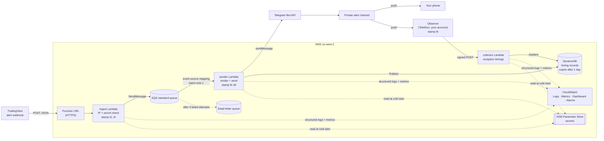
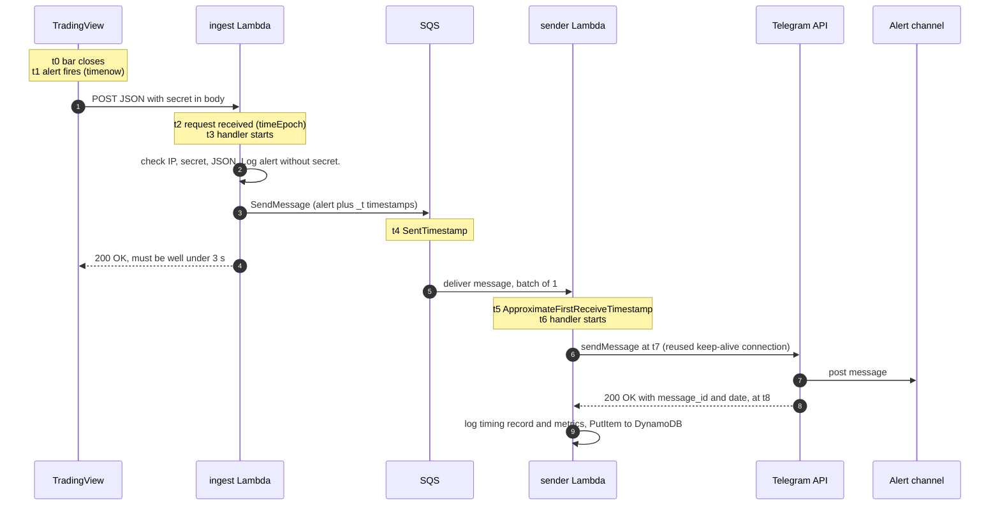
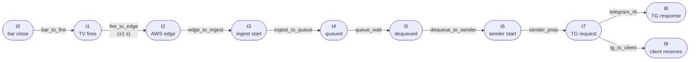
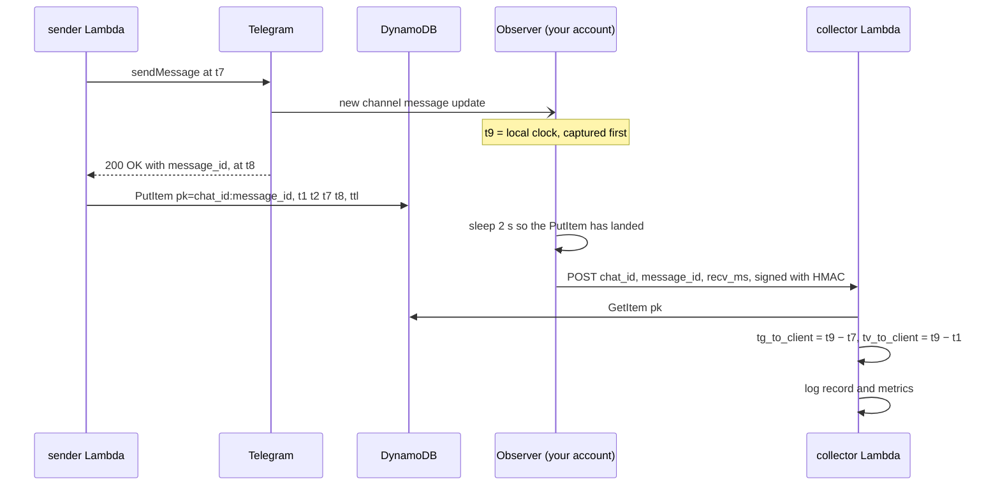
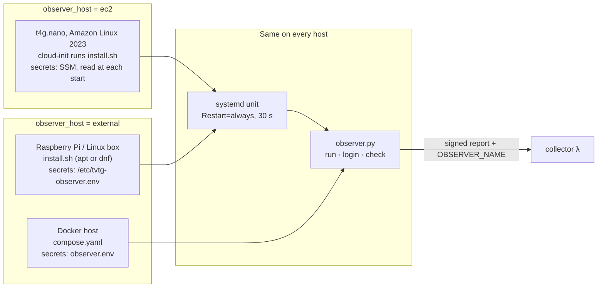
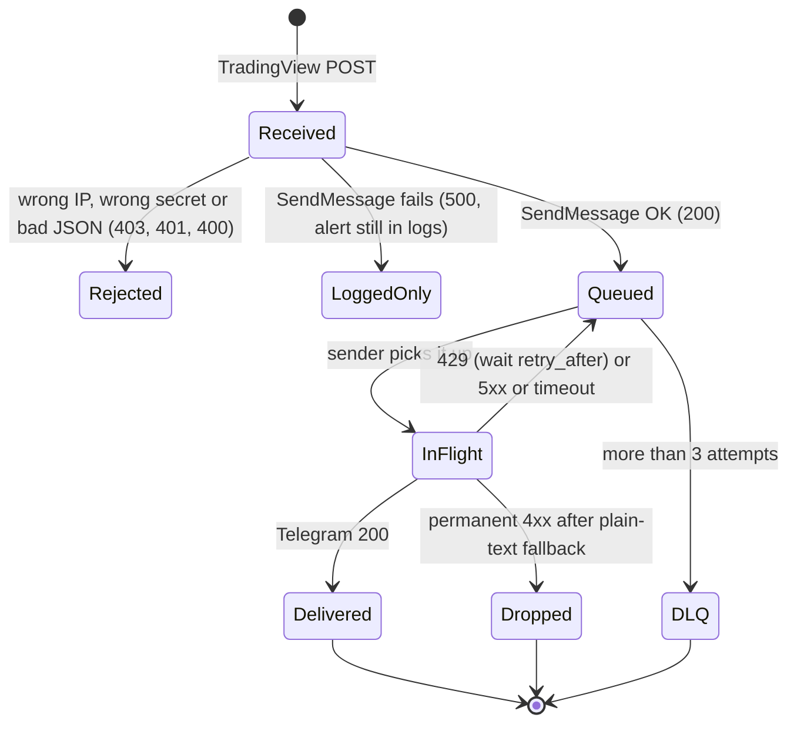
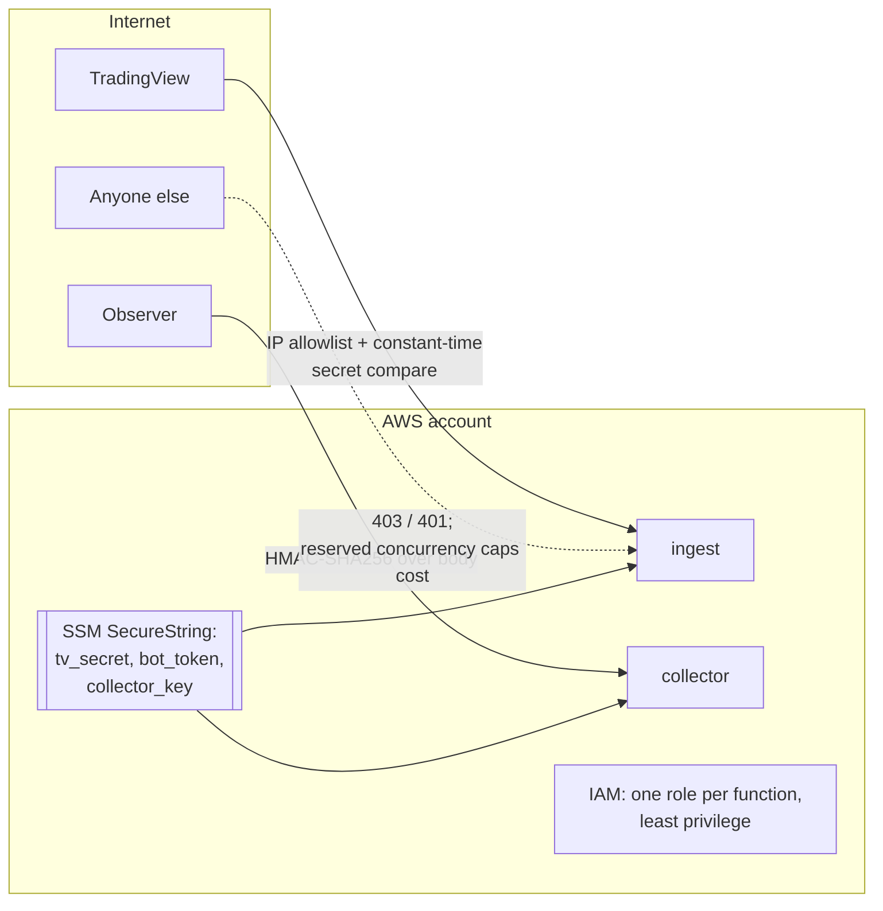
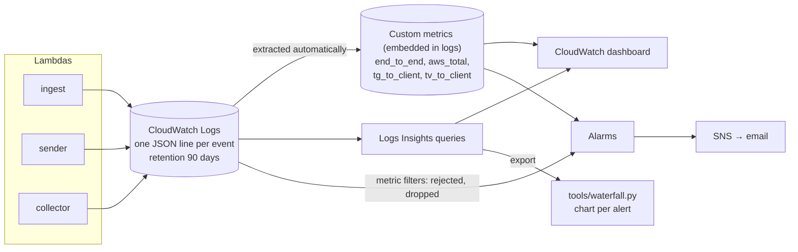
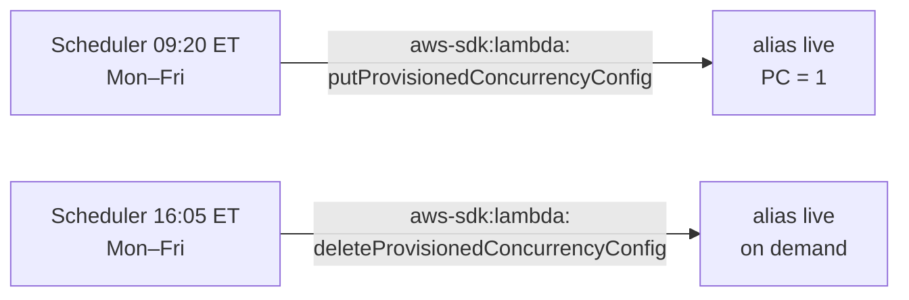

# Design: TradingView → AWS → Telegram alert bot

Status: **Implemented locally, not yet deployed** · Last updated: 2026-11-14 · Plan: [plan.md](plan.md) · Deploy: [deploy.md](deploy.md)

This bot forwards TradingView alerts to a Telegram channel through AWS. Every alert is timed at each step, from the
TradingView bar close to the moment a real Telegram client receives the message, and those timings are graphed in
CloudWatch.

- [1. Constraints we design around](#1-constraints-we-design-around)
- [2. Architecture](#2-architecture)
- [3. Alert path, step by step](#3-alert-path-step-by-step)
- [4. Timing model](#4-timing-model)
- [5. Reception measurement](#5-reception-measurement)
- [6. Failure handling](#6-failure-handling)
- [7. Security](#7-security)
- [8. Observability](#8-observability)
- [9. Warm starts](#9-warm-starts)
- [10. Data contracts](#10-data-contracts)
- [11. Cost](#11-cost)
- [12. Decision log](#12-decision-log)

---

## 1. Constraints we design around

| Constraint | Source | Consequence |
|---|---|---|
| Webhook requests time out after **3 s** and aren't retried | TradingView | Ingest only checks the alert, queues it and returns 200. Telegram is never called while TradingView waits. |
| No custom headers | TradingView | The shared secret travels in the JSON body. |
| Ports 80/443 only; account needs 2FA | TradingView | Lambda Function URL (HTTPS 443). |
| Requests come from 4 fixed IPs (`52.89.214.238`, `34.212.75.30`, `54.218.53.128`, `52.32.178.7`) | TradingView | IP allowlist in the ingest Lambda. The IPs look like AWS us-west-2, so deploy there. |
| `{{timenow}}` is only accurate to the second (rounded down) | TradingView | The first hop's timing reads up to 1 s high. Everything after that is accurate to the ms. |
| More than 15 triggers in 3 minutes stops an alert | TradingView | The canary alert fires at most once a minute. |
| Bots can't see messages from other bots; `message.date` is the server time the message was accepted, in whole seconds | Telegram | A second bot can't measure reception. A user-account client has to. See §5. |
| About 1 msg/s per chat, 20 msg/min per group, 429 responses carry `retry_after` | Telegram | Cap sender concurrency and honor `retry_after`. |

## 2. Architecture



| Component | Responsibility | Key settings |
|---|---|---|
| **ingest** | Check source IP, secret and JSON. Stamp timestamps, log the alert (secret removed), enqueue it, return 200. | 256 MB arm64, timeout 5 s (longer than TradingView's 3 s, so a slow cold start still gets the alert queued), reserved concurrency 5 in prod |
| **SQS queue** | Holds alerts between ingest and sender; retries failed sends. | Standard queue, visibility 90 s (6× sender timeout), `maxReceiveCount` 3 → DLQ |
| **sender** | Turn the alert into a message, send it to Telegram over a reused connection, emit the timing record. | 256 MB arm64, timeout 15 s, batch size 1, no batching window, ESM max concurrency 2, partial batch failures |
| **DynamoDB** | Keyed by `chat_id:message_id`: holds t1/t2/t7/t8 so reception can be matched up later. | On-demand, TTL 1 day |
| **collector** | Receive the observer's reports, match them with the stored timings, emit reception timings. | Function URL, HMAC auth, no provisioned concurrency |
| **observer** | Your own Telegram account, logged in on an always-on machine; records when each message arrives. | Telethon, chrony-synced clock, systemd service |

## 3. Alert path, step by step



## 4. Timing model

### Timestamps

| # | Moment | Captured from | Clock | Precision |
|---|---|---|---|---|
| t0 | Bar closes | `{{time}}` + `{{interval}}` (intraday bar-close alerts only) | TradingView | exact |
| t1 | Alert fires | `{{timenow}}` | TradingView | 1 s, rounded down |
| t2 | AWS receives the request | `requestContext.timeEpoch` | AWS | ms |
| t3 | Ingest handler starts | `time.time_ns()` | Lambda | ms |
| t4 | Message queued | SQS `SentTimestamp` | AWS | ms |
| t5 | First picked up from the queue | SQS `ApproximateFirstReceiveTimestamp` | AWS | ms |
| t6 | Sender handler starts | `time.time_ns()` | Lambda | ms |
| t7 | Telegram request sent | `time.time_ns()` | Lambda | ms |
| t8 | Telegram response received | `time.time_ns()` | Lambda | ms |
| t9 | A Telegram client receives the message | Observer's clock | Observer (chrony) | ms ± clock offset |

AWS keeps its clocks in sync (Amazon Time Sync), so t2–t8 can be compared directly. t1 comes from TradingView's clock
and t9 from the observer's.

### Segments



| Segment | Formula | Mostly measures | What makes it worse |
|---|---|---|---|
| `bar_to_fire` | t1 − t0 | TradingView's evaluation delay | TradingView load |
| `fire_to_edge` | t2 − t1 | TradingView's queue and the internet | TradingView load; reads up to 1 s high by design |
| `edge_to_ingest` | t3 − t2 | Lambda invoke, including **cold start** | Cold starts, low memory size |
| `ingest_to_queue` | t4 − t3 | Checks + SQS SendMessage | Secret lookup on a cold start |
| `queue_wait` | t5 − t4 | SQS poller pickup | Usually tens of ms |
| `dequeue_to_sender` | t6 − t5 | Sender invoke, including **cold start** | Cold starts |
| `sender_prep` | t7 − t6 | Building the message | Should be ~0 |
| `telegram_rtt` | t8 − t7 | Bot API round trip (US ↔ EU) | New TLS connection (`tg_new_conn`) |
| `tg_to_client` | t9 − t7 | Telegram pushing the message to a client | Telegram load. Measured from t7 because the push can arrive before t8. |
| **`aws_total`** | t8 − t2 | Everything we control | — |
| **`end_to_end`** | t8 − t1 | Alert to Telegram accepting the message | — |
| **`tv_to_client`** | t9 − t1 | What a person actually experiences | — |

## 5. Reception measurement

**Why not a second bot (the Copilot proposal):** bots never see messages from other bots, and the `date` field it
would read is the time the server accepted the message, in whole seconds. Bot A already gets that same value back
from `sendMessage`. Only a Telegram *client* knows when a message arrived, so the observer is your own account,
connected through MTProto (Telethon).



- **Matching key:** `chat_id:message_id`. Alerts go to a **private channel**, where message IDs are the same for
  every member. In one-to-one chats each account numbers messages separately, so the IDs wouldn't match.
- **Clock:** the observer's clock error lands directly in t9. Run it on an always-on Linux box with chrony and check
  `chronyc tracking`. Don't run it under WSL, whose clock drifts after the host sleeps.
- **It's a proxy for your phone:** it times Telegram pushing to *a* client near you. Mobile push delivery adds
  network-dependent delay that nothing on the server side can see.
- The observer is optional and kept separate. The alert path never depends on it.

**Hosting is configurable** (`observer_host` in each environment). The program, the systemd unit and the installer
are the same everywhere; only the way it's provisioned and where its secrets come from change:



- Secrets resolve in this order: environment / env file first, then SSM (`OBSERVER_SSM_PREFIX`,
  `COLLECTOR_KEY_SSM`). A value that still reads `CHANGE_ME` counts as unset. The process then exits with code 78
  and systemd retries, so a host starts by itself once its secrets exist.
- The session is a Telethon `StringSession` (`TG_SESSION`), created once with `observer.py login` on any machine.
  No interactive step happens on the host, which makes EC2 and Docker reproducible. Use one login per host.
- Every report carries `OBSERVER_NAME`, so several observers (say, a Pi at home and EC2 in a nearby region) can run
  at once and show up as separate rows on the dashboard.
- `observer.py check` validates the config, refuses WSL, and reads the clock offset from `chronyc`. The installer
  runs it, and so can you at any time.

## 6. Failure handling



| Failure | Behavior | Signal |
|---|---|---|
| Unknown IP / bad secret | 403 / 401; IP logged, secret never logged | `rejected` log lines → metric filter → alarm when there's a sudden rise (TradingView may have changed its IPs) |
| SQS unavailable | 500 to TradingView; alert stays in logs as `event=ingest` for manual replay | Lambda `Errors` alarm |
| Telegram 429 | Change the message's visibility to `retry_after`, report the item as failed, SQS retries | `telegram_status` in logs |
| Telegram 5xx / timeout | Drop the cached connection, report the item as failed, SQS retries after the visibility timeout | as above |
| Telegram 400 (formatting) | Retry once as plain text; if that fails too, log `event=dropped` and acknowledge (no retry loop) | `dropped` count alarm |
| Too many retries | Message moves to the DLQ | `ApproximateNumberOfMessagesVisible > 0` alarm on the DLQ |
| Duplicate delivery (SQS is at-least-once) | Rare; tolerated | `receive_count > 1` in logs |

A standard queue is used rather than FIFO. With FIFO, one stuck message holds up every later alert in its group.

## 7. Security



- Secrets live in SSM Parameter Store (SecureString), are read once when a Lambda starts, and are never stored in
  Terraform state as plaintext or in environment variables.
- The secret is removed from the alert before anything is logged or queued. A unit test checks this.
- The TradingView IP list is an SSM parameter, so an IP change doesn't require a redeploy.
- CI deploys through GitHub OIDC → an IAM role. There are no long-lived AWS keys in GitHub.
- The observer's Telethon session file is as sensitive as a login: store it `chmod 600` on the observer host only, and
  never commit it.
- **Security scanning:** ASH v3.8.0 (bandit, semgrep/opengrep, checkov, detect-secrets, gitleaks, grype, syft,
  trivy, actionlint, zizmor) runs locally (`make ash`) and in `ash.yml`, and fails on unsuppressed MEDIUM or above.
  Config: `.ash/.ash.yaml`. Accepted risks are inline `#checkov:skip=<id>:<reason>` comments on the resource they
  concern (public Function URLs authenticated in code, AWS-managed keys instead of CMKs, no VPC, …), so each
  reason sits next to the code. Notably, the SNS topic stays unencrypted because CloudWatch alarms can't publish to
  a topic encrypted with the `aws/sns` managed key.
- GitHub workflows pin every action to a commit SHA, check out without persisted credentials, declare permissions
  per job, and pass `vars`/`inputs` to shell steps through `env:` (no `${{ }}` inside `run:`).

## 8. Observability



Why mostly logs: every alert's full timing record stays queryable, and only 4 values become paid custom metrics
(~$0.30 each per month). Percentiles are computed from raw values, never averaged.

**Dashboard widgets**

1. `end_to_end` and `tv_to_client`: p50 / p90 / p99 over time (metric).
2. `aws_total` p50 / p99 (metric).
3. Median of each segment, stacked, per hour (Logs Insights):
   ```
   filter event = "delivered"
   | stats pct(edge_to_ingest, 50) as edge_to_ingest, pct(ingest_to_queue, 50) as ingest_to_queue,
           pct(queue_wait, 50) as queue_wait, pct(dequeue_to_sender, 50) as dequeue_to_sender,
           pct(telegram_rtt, 50) as telegram_rtt by bin(1h)
   ```
4. Cold vs warm: `stats count(*), pct(aws_total, 50), pct(aws_total, 99) by ingest_cold, sender_cold, tg_new_conn`.
5. Last 50 alerts, one row each with every segment (Logs Insights table).
6. Health: DLQ depth, Lambda errors/throttles, rejected requests, Telegram non-200 responses.

**Alarms:** DLQ not empty; Lambda errors; `end_to_end` p90 > 3 s; rejected-request spike; **canary missing** (the
canary has had no `end_to_end` samples for 5 min, with missing data counted as breaching). The last one catches
TradingView, AWS or Telegram outages, plus an expired TradingView alert.

**Canary:** a TradingView alert on a 1-minute BTCUSD chart, firing once per bar close and marked `"canary": true`. It
goes to a muted canary channel the observer is also in, so the timings never run dry.

## 9. Warm starts

Alerts are infrequent, so without help nearly every alert starts **two** cold Lambdas. Ingest and sender are on the
alert's path; the collector isn't.

- Provisioned concurrency requires `publish = true` and an alias (`live`). The Function URL `qualifier` and the SQS
  event source mapping must both point at the alias, or the warm instances are never used.
- **Crypto (24/7):** keep `aws_lambda_provisioned_concurrency_config` = 1 on the alias permanently. That's about
  $1.35/month per function at 128 MB, roughly doubling at 256 MB.
- **Equities hours:** EventBridge Scheduler calls the Lambda API directly (no code) with `America/New_York` time:
  `putProvisionedConcurrencyConfig` at 09:20 Mon–Fri and `deleteProvisionedConcurrencyConfig` at 16:05. Warming up
  takes a few minutes, which is why it starts at 09:20.
- **Keep-alive pings** (`keepalive_minutes`): Scheduler invokes ingest and sender with `{"keepalive": true}` every N
  minutes. Ingest pre-fetches its secret and opens its SQS connection; sender calls `getMe`. This is cheap and
  best-effort for containers, but it is the **only** thing that keeps the *Telegram* connection warm. Provisioned
  concurrency keeps the container alive, not the TCP/TLS session. Mock data with alerts ~20 min apart shows ~85% of
  sends paying a fresh TLS handshake (~300 ms more) when it's absent. That number assumes Telegram drops idle
  connections after ~4 min; Phase 3 measures the real value through `tg_new_conn`.



Phase 3 settles memory size and provisioned concurrency using measured cold-vs-warm numbers rather than guesses.

## 10. Data contracts

**TradingView alert message** (pasted into the alert's Message box):

```json
{
  "secret": "<from SSM>",
  "ticker": "{{ticker}}",
  "exchange": "{{exchange}}",
  "interval": "{{interval}}",
  "price": "{{close}}",
  "bar_time": "{{time}}",
  "fired_at": "{{timenow}}",
  "msg": "Long breakout",
  "canary": false
}
```

**SQS message body:** the alert with `secret` removed, plus
`"_t": {"id": "<requestId>", "t2": <ms>, "t3": <ms>, "ingest_cold": <bool>}`.

**Timing record** (`event = "delivered"`, one per alert, emitted by the sender):

| Field | Type | Notes |
|---|---|---|
| `event` | str | `delivered` |
| `alert_id` | str | Function URL request ID |
| `ticker`, `interval`, `canary` | str / bool | |
| `chat_id`, `message_id` | int | Key for reception matching |
| `t1` … `t8` | int (epoch ms) | Raw timestamps, kept for waterfall charts |
| `bar_to_fire` … `telegram_rtt`, `aws_total`, `end_to_end` | int (ms) | Segments from §4 |
| `ingest_cold`, `sender_cold`, `tg_new_conn` | bool | Explain the outliers |
| `receive_count` | int | > 1 means the message was retried |
| `telegram_status` | int | HTTP status of the final attempt |

**DynamoDB item** (`pk = "<chat_id>:<message_id>"`): `t1`, `t2`, `t7`, `t8` (N, epoch ms), `ttl` (N, epoch s, +1 day).

**Observer → collector:** `{"chat_id": -100…, "message_id": 123, "recv_ms": 1763160000123}` with header
`X-Sig: hex(HMAC-SHA256(collector_key, body))`.

**Reception record** (`event = "received"`, emitted by the collector): `pk`, `t9`, `tg_to_client`, `tv_to_client`.

## 11. Cost

Personal volume (fewer than 10k alerts a month), us-west-2:

| Item | Monthly |
|---|---|
| Lambda requests and compute, SQS, DynamoDB, Function URLs | ≈ $0 (free tier / cents) |
| 4 custom metrics | $1.20 |
| ~6 alarms | $0.60 |
| Dashboard (first 3 free) | $0 |
| Logs ingestion + Logs Insights scans | < $0.50 |
| Provisioned concurrency, 2 functions × 128 MB, 24/7 | ~$2.70 (~$0.50 if equities hours only) |
| Observer, only if `observer_host = "ec2"`: t4g.nano + public IPv4 + 8 GB gp3 | ~$7.40 |
| **Total** | **≈ $3–5** (≈ $10–13 with an EC2 observer) |

## 12. Decision log

| # | Decision | Alternatives rejected | Why |
|---|---|---|---|
| D1 | Lambda Function URL for ingest | API Gateway HTTP/REST API | Free, one less hop, same event format. Throttling comes from reserved concurrency instead. |
| D2 | Separate ingest and sender with SQS between them | One Lambda that calls Telegram directly | TradingView's 3 s timeout and lack of retries; Telegram errors and 429s need retries. The cost of the extra hop is measured (`queue_wait`). |
| D3 | **Standard** SQS queue | FIFO (my earlier draft) | FIFO lets one stuck message hold up every later alert. Strict ordering isn't needed; `fired_at` is in every message. |
| D4 | us-west-2 | us-east-1, eu-west-1 (nearer Telegram) | TradingView's webhook IPs look like us-west-2. Revisit using `fire_to_edge` vs `telegram_rtt` data. |
| D5 | Log-first instrumentation, 4 custom metrics | Metric per segment; X-Ray | Full per-alert detail at a fraction of the cost. X-Ray can't see TradingView or Telegram anyway. |
| D6 | User-account observer (Telethon) | Second bot (Copilot) | Bots can't see bot messages; `message.date` is the server accept time. |
| D7 | DynamoDB only to match reception reports | DynamoDB + per-minute scan aggregator (Copilot) | The scan approach double-counts and averages percentiles; matching on arrival is simpler and correct. |
| D8 | Provisioned concurrency on a `live` alias; Scheduler universal targets for market hours | `$LATEST` (not allowed); `UpdateFunctionConfiguration` (wrong API); UTC-only EventBridge rules | Correct API, aware of daylight saving, no extra code. |
| D9 | Python 3.12 on arm64, stdlib `http.client` for Telegram, the runtime's boto3 | requests/httpx, python-telegram-bot; 3.13 | No dependencies to package; a reused keep-alive connection is the main latency win. 3.12 matches the local and CI interpreter. |
| D10 | Terraform, state in S3 with `use_lockfile`; GitHub Actions with OIDC (separate read-only plan role and deploy role) | SAM/CDK; static keys | Matches the existing Terraform preference; no DynamoDB lock table or stored secrets. |
| D11 | Scheduled keep-alive pings, alongside provisioned concurrency | Provisioned concurrency alone | Provisioned concurrency doesn't keep the Telegram TLS session open; pings do, for ~$0. |
| D13 | Observer host selectable: `none`, `external` (Pi / Linux / Docker) or `ec2`; one program, secrets from env or SSM | Pi-only; separate code per host | Home hardware gives the most representative numbers; EC2 needs no hardware; Docker covers everything else. One code path keeps them consistent. |
| D14 | ASH scan as a required check, locally and in CI; risks accepted inline with reasons | Ad-hoc linters; suppressing in bulk | One pinned tool covers code, IaC, secrets, dependencies and workflows; inline reasons keep each accepted risk reviewable. |
| D12 | Retried alerts (receive_count > 1) shown separately in graphs | Mixed into the percentiles | A 90 s visibility timeout swamps every latency chart; retries are an error path with their own table. |
