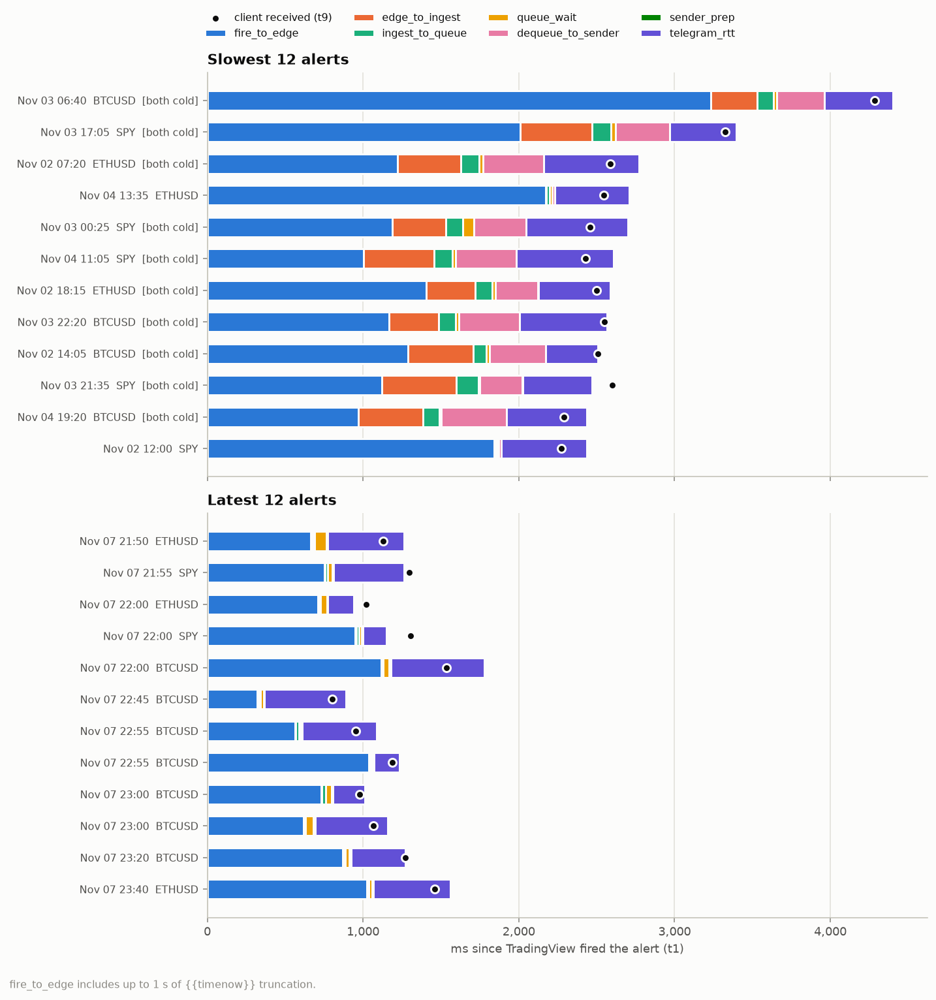
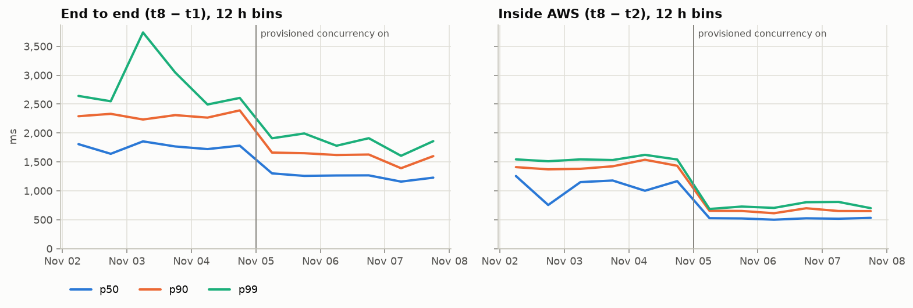
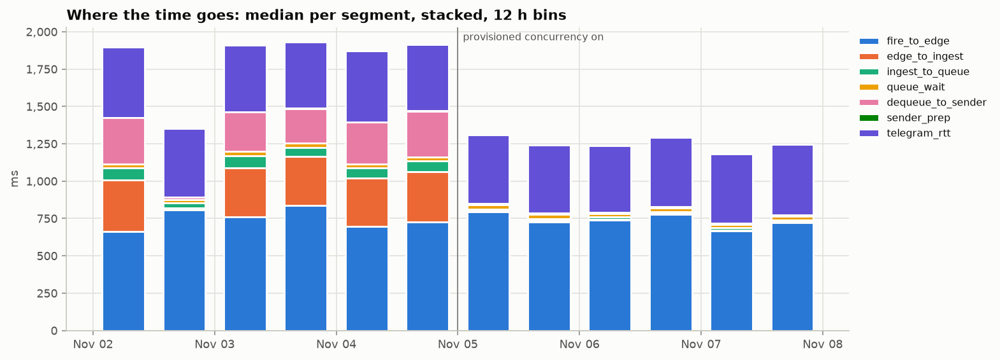
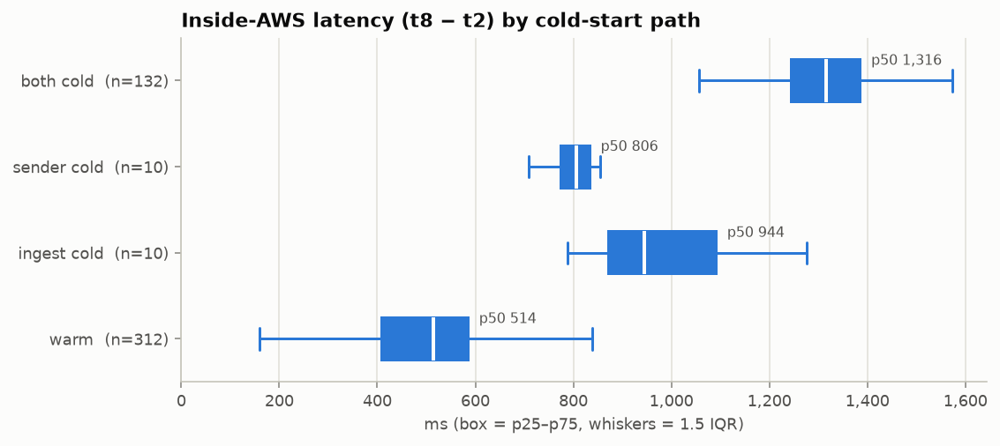
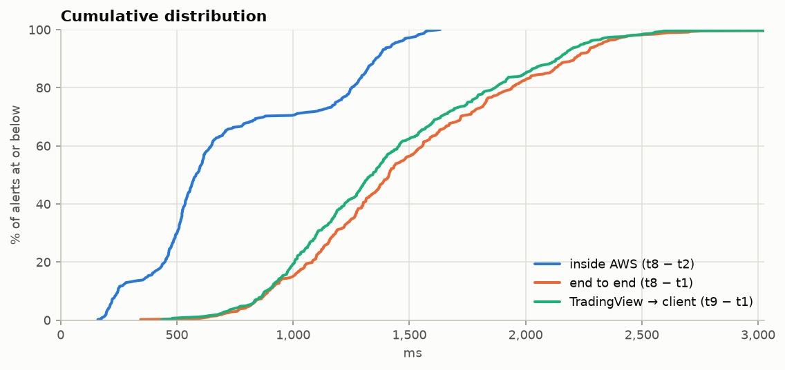
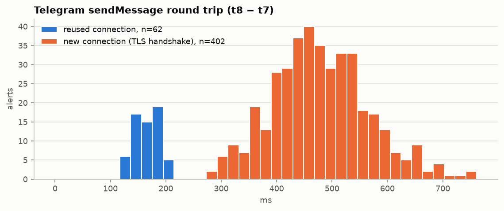

# Latency summary

464 alerts, 2026-11-02 00:10 → 2026-11-07 23:40 UTC.
Cold-start paths: warm 312 (67%), ingest cold 10 (2%), sender cold 10 (2%), both cold 132 (28%).

| Segment | n | p50 ms | p90 ms | p99 ms | max ms |
|---|---:|---:|---:|---:|---:|
| `bar_to_fire` | 464 | 0 | 1,000 | 1,000 | 2,000 |
| `fire_to_edge` | 464 | 733 | 1,078 | 1,440 | 3,234 |
| `edge_to_ingest` | 464 | 7 | 412 | 476 | 549 |
| `ingest_to_queue` | 464 | 18 | 107 | 168 | 194 |
| `queue_wait` | 464 | 26 | 50 | 75 | 109 |
| `dequeue_to_sender` | 464 | 9 | 358 | 427 | 491 |
| `sender_prep` | 464 | 1 | 2 | 2 | 2 |
| `telegram_rtt` | 464 | 458 | 586 | 739 | 835 |
| `aws_total` | 464 | 582 | 1,356 | 1,566 | 1,632 |
| `end_to_end` | 464 | 1,412 | 2,211 | 2,643 | 4,402 |
| `tg_to_client` | 464 | 372 | 495 | 612 | 1,100 |
| `tv_to_client` | 464 | 1,342 | 2,139 | 2,553 | 4,285 |

`fire_to_edge` includes up to 1 s of `{{timenow}}` truncation. `bar_to_fire` is whole seconds for the same reason.

3 retried alerts (SQS redelivery) are left out of the table and charts above:

| Alert | Delivered (UTC) | Attempts | queue_wait ms | end_to_end ms |
|---|---|---:|---:|---:|
| `mock-1106` | 2026-11-03 06:06:02 | 2 | 60,038 | 62,025 |
| `mock-1169` | 2026-11-03 22:26:01 | 2 | 60,015 | 60,434 |
| `mock-1417` | 2026-11-07 06:41:00 | 2 | 60,011 | 60,744 |

