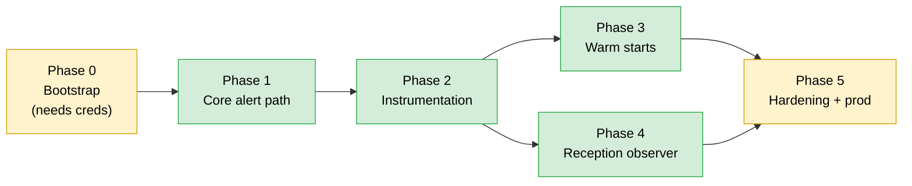
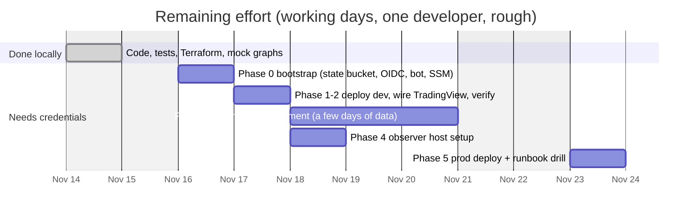
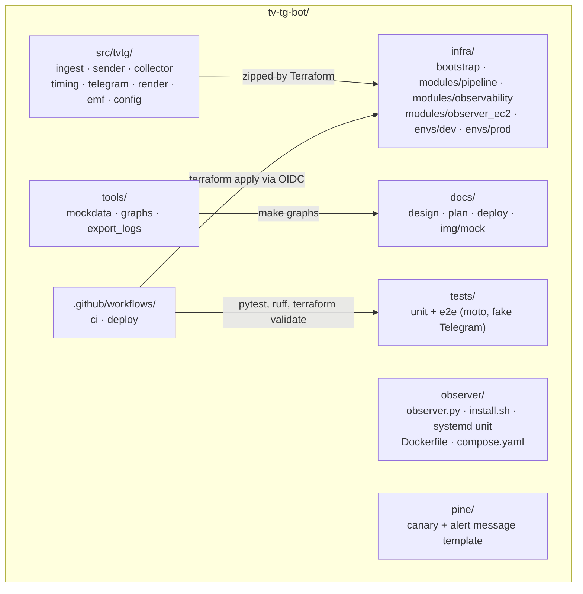
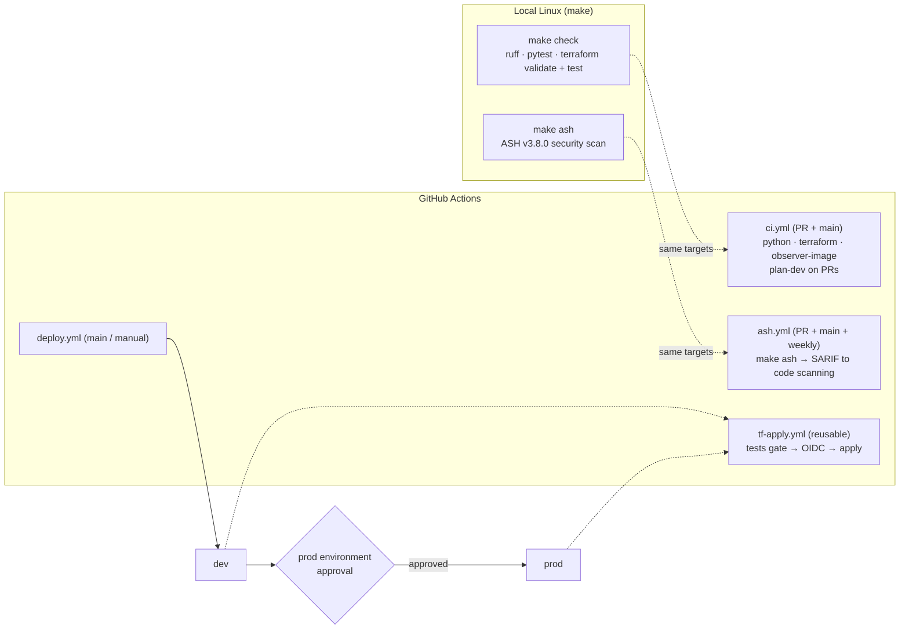

# Implementation plan

Status: **Phases 1–4 are implemented and tested locally. Deploying needs AWS and GitHub credentials (Phase 0).**
Design: [design.md](design.md) · Deploy steps: [deploy.md](deploy.md)

## Phases

Green: code, Terraform and tests exist in this repo. Yellow: needs your AWS account / GitHub repo.

---

### Phase 0: Bootstrap (needs credentials)

- [ ] Create a GitHub repo and push this directory.
- [ ] `infra/bootstrap`: apply once with admin credentials. It creates the Terraform state bucket and the GitHub OIDC
      deploy role.
- [ ] Set the GitHub repo variables `AWS_DEPLOY_ROLE_ARN` and `TF_STATE_BUCKET`, and create the `prod` environment
      with a required reviewer.
- [ ] BotFather: create the bot. Create a private alert channel and a muted canary channel, and add the bot to both
      as an admin.
- [ ] Turn on 2FA in TradingView.
- [ ] Check the TradingView webhook IPs against AWS `ip-ranges.json` to confirm us-west-2.

**Exit:** `terraform plan` succeeds in CI for `envs/dev`.

### Phase 1: Core alert path ✅ code

- [x] `ingest`: IP allowlist, constant-time secret check, secret removed before logging, body-size limit, enqueue,
      timestamps t2/t3.
- [x] `sender`: Telegram client that reuses its connection, recovers from stale connections, falls back to plain text
      on 400, honors `retry_after` on 429, reports partial batch failures, and treats every step after a successful
      send as best-effort.
- [x] SQS standard queue + DLQ, the trigger pointed at the `live` alias.
- [x] Tests: unit, plus an end-to-end test (moto SQS/DynamoDB/SSM + fake Telegram server).
- [ ] Deploy to dev, `curl` a test alert, then create the real TradingView alert.

**Exit:** a TradingView alert reaches the channel; ingest p99 < 500 ms; a test message reaches the DLQ and the alarm
fires.

### Phase 2: Instrumentation ✅ code

- [x] Timing record per alert (`event=delivered`) with t0–t8, segments and cold/new-connection flags.
- [x] Custom metrics embedded in the logs: `end_to_end`, `aws_total`.
- [x] Dashboard (Logs Insights + metrics) and alarms in Terraform; SNS email.
- [x] `tools/mockdata.py` → `tools/graphs.py`: mock graphs; the same graph code runs on real exports
      (`tools/export_logs.py`).
- [x] TradingView canary indicator (`pine/canary.pine`).
- [ ] Turn on the canary alert; check the dashboard against `tools/graphs.py` output from real data.

**Exit:** every segment appears on the dashboard; the canary-missing alarm fires when the canary alert is paused.

### Phase 3: Warm starts ✅ code

- [x] `provisioned_concurrency_mode = off | always | market_hours` (Scheduler universal targets, `America/New_York`).
- [x] `keepalive_minutes`: scheduled pings that keep containers *and the Telegram connection* warm.
- [ ] Experiment: 2–3 days each of `off`, `keepalive` only, and `always` + `keepalive`, at 128 and 256 MB.
      Compare `edge_to_ingest`, `dequeue_to_sender`, `telegram_rtt` and `aws_total` p99, grouped by cold and
      `tg_new_conn` flags.
- [ ] Record the decision in design.md §12.

**Exit:** the provisioned concurrency mode and memory size are chosen from data.

### Phase 4: Reception observer ✅ code

- [x] DynamoDB timing records (sender), `collector` with HMAC auth (Function URL).
- [x] `observer/observer.py` (Telethon), with retries when the collector hasn't seen the message yet; systemd unit.
- [x] Configurable host: `observer_host = none | external | ec2`. `install.sh` (apt/dnf), Docker/compose, and a
      Terraform `observer_ec2` module (t4g.nano, SSM secrets, Session Manager, no SSH). `observer.py check`
      validates config and clock; the `observer-missing` alarm covers every host type.
- [ ] Pick a host (deploy.md step 8), log in, confirm `check` passes and the clock offset is under 20 ms.

**Exit:** `tg_to_client` and `tv_to_client` appear on the dashboard for both real and canary alerts.

### Phase 5: Hardening + prod

- [ ] `envs/prod` apply, gated by the `prod` GitHub environment.
- [ ] Runbook drill: replay an alert from the logs (`event=ingest`), redrive the DLQ, rotate the secrets.
- [ ] AWS Budget alarm at $10/month.
- [ ] Optional: region experiment (eu-west-1 sender) if `telegram_rtt` dominates.

## Repository layout

## CI/CD

Every check runs locally first (`make check-all`) and the same Makefile targets run in GitHub Actions. All actions are
pinned to commit SHAs, and every job declares its own minimal permissions.

| Workflow | Trigger | Does | Needs |
|---|---|---|---|
| `ci.yml` | PR, push to main | lint, 195 tests (coverage ≥ 95%), mock graphs, terraform fmt/validate/test, observer Docker build; `plan-dev` on PRs | nothing (plan: `AWS_PLAN_ROLE_ARN`) |
| `ash.yml` | PR, push to main, weekly, manual | ASH scan; fails on unsuppressed MEDIUM+; SARIF to code scanning, reports as artifact | nothing |
| `deploy.yml` → `tf-apply.yml` | push to main, manual | tests, then `terraform apply` dev; prod after approval | `AWS_DEPLOY_ROLE_ARN`, `TF_STATE_BUCKET`, env vars |

`deploy.yml` does nothing until the `AWS_DEPLOY_ROLE_ARN` variable is set.

## Open questions (defaults in use)

| Question | Default |
|---|---|
| Which markets? (decides the provisioned concurrency mode) | Crypto → `always` in prod, `off` in dev |
| Alert destinations | One private alert channel + one muted canary channel |
| Observer host | `observer_host = "none"` until chosen; then a home Pi (`external`) or `ec2` in the region nearest you |
| Ops notifications | SNS email |
| Region | us-west-2 |

## Risks

| Risk | Mitigation |
|---|---|
| TradingView changes its webhook IPs → alerts get 403 | IP list in SSM (no redeploy); alarm on rejected requests; the canary-missing alarm |
| Telegram 429 during bursts | Sender concurrency capped at 2; `retry_after` honored |
| Telethon user session misuse or account restriction | Read-only, your own api_id; session file `chmod 600`; the observer is optional and separate |
| Observer clock drift skews `tg_to_client` | chrony; drift checked in the deploy steps; values shown next to `telegram_rtt` for a sanity check |
| A stuck message holds up later alerts | Standard queue (not FIFO); permanent 4xx acknowledged rather than retried |
| Secret leaks through logs | Secret removed before any log or queue write; unit test checks it |
| Vulnerable dependency or insecure IaC/workflow slips in | ASH on every PR, push and weekly (new CVEs); findings suppressed only inline with a reason |
